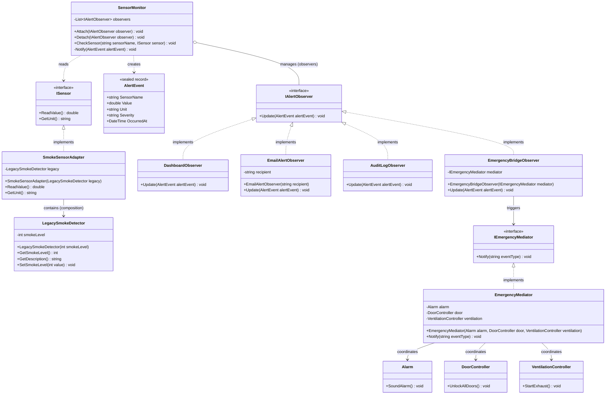

# Báo Cáo Thực Hành Mẫu Thiết Kế: Campus Safety Hub

- **Môn học:** Mẫu Thiết Kế Phần Mềm (Design Patterns)
- **Sinh viên thực hiện:** Sinh viên năm 2 IT / Kỹ thuật Phần mềm
- **Chủ đề:** Trung tâm giám sát an toàn phòng máy (Campus Safety Hub)

---

## 1. Sơ đồ lớp (Class Diagram)

---

## 2. Trách nhiệm của các thành phần trong hệ thống

| Lớp / Interface | Trách nhiệm chính |
|:---|:---|
| `ISensor` | Giao diện chuẩn mực mà module giám sát sử dụng (`ReadValue()`, `GetUnit()`). |
| `LegacySmokeDetector` | Lớp cảm biến khói cũ có sẵn, thang đo 0..1000, không được phép sửa đổi. |
| `SmokeSensorAdapter` | Chuyển đổi giao diện và quy đổi thang đo 0..1000 thành phần trăm 0..100.0% smoke. |
| `AlertEvent` | Đối tượng dữ liệu bất biến (immutable record) chứa thông tin mô tả cảnh báo. |
| `IAlertObserver` | Giao diện trừu tượng nhận cảnh báo (`Update(AlertEvent)`). |
| `SensorMonitor` | Quản lý danh sách observer, đọc cảm biến, so ngưỡng và phát thông báo cảnh báo. |
| `EmergencyBridgeObserver` | Observer đóng vai trò cầu nối: lọc sự kiện `CRITICAL` và kích hoạt mediator. |
| `IEmergencyMediator` | Hợp đồng giao tiếp điều phối phản ứng khẩn cấp. |
| `EmergencyMediator` | Điều phối tập trung còi báo động (`Alarm`), cửa (`DoorController`) và quạt hút khói (`VentilationController`). |

---

## 3. Trả lời các câu hỏi thiết kế

### 1. Adapter nên kế thừa hay chứa LegacySmokeDetector?
**Trả lời:** Nên dùng quan hệ **CHỨA (Composition / Object Adapter)** thay vì kế thừa (Inheritance).  
*Lý do:*  
- Lớp `LegacySmokeDetector` đã được đánh dấu `sealed`, do đó trong C# không thể kế thừa trực tiếp.
- Tuân thủ nguyên lý *"Ưu tiên thành phần hơn kế thừa"* (Favor composition over inheritance): Giúp adapter độc lập, chỉ giữ tham chiếu đối tượng cũ và dễ dàng thay thế mà không gây xáo trộn cây kế thừa.

### 2. SensorMonitor có nên biết EmailAlertObserver cụ thể không?
**Trả lời:** **KHÔNG**. `SensorMonitor` chỉ nên phụ thuộc vào abstraction `IAlertObserver`.  
*Lý do:*  
- Tuân thủ nguyên lý Đóng/Mở (OCP) và Nghịch đảo phụ thuộc (DIP). `SensorMonitor` không cần quan tâm tin nhắn được hiển thị lên màn hình, gửi email hay lưu audit log. Khi cần thêm phương thức thông báo mới (như gửi SMS hay Telegram), ta chỉ việc tạo observer mới mà không cần sửa code của `SensorMonitor`.

### 3. Alarm có cần tham chiếu đến DoorController không?
**Trả lời:** **KHÔNG**.  
*Lý do:*  
- Đây là giá trị cốt lõi của **Mediator Pattern**. Còi báo động (`Alarm`), Cửa thoát hiểm (`DoorController`) và Hệ thống thông gió (`VentilationController`) là các thành phần độc lập. Nếu chúng tham chiếu chéo lẫn nhau thì hệ thống sẽ biến thành mạng nhện phụ thuộc chằng chịt (tight coupling). Mọi sự phối hợp giữa chúng được ủy quyền toàn bộ cho `EmergencyMediator`.

### 4. Ai chịu trách nhiệm quyết định giá trị nào là vượt ngưỡng?
**Trả lời:** **`SensorMonitor` (Module Giám sát / Lớp Nghiệp vụ).**  
*Lý do:*  
- Cảm biến (`ISensor`) chỉ đóng vai trò đo đạc và trả về số liệu vật lý thực tế. Việc định nghĩa mức nào là Bình thường (<50%), mức nào là Cảnh báo (50..70% WARNING) và mức nào là Nguy hiểm (>=70% CRITICAL) thuộc về chính sách an toàn nghiệp vụ của trung tâm điều hành (`SensorMonitor`). Việc tách biệt này giúp ta linh hoạt thay đổi ngưỡng mà không cần can thiệp vào phần cứng cảm biến.

---

## 4. Phân tích Trade-off chuyên sâu (Theo Rubric chấm điểm)

### 4.1. Đánh đổi khi áp dụng Adapter Pattern
- **Lợi ích đạt được:** Tái sử dụng trọn vẹn lớp thư viện cũ `LegacySmokeDetector` mà không cần viết lại mã nguồn, duy trì tính ổn định của hệ thống hiện hữu và tuân thủ chuẩn mới `ISensor`.
- **Trade-off (Sự đánh đổi):** 
  - Tạo thêm một tầng trung gian gián tiếp (indirection) và cấp phát thêm một đối tượng trên bộ nhớ (memory overhead).
  - Nếu số lượng cảm biến cũ quá đa dạng với các API khác nhau, số lượng lớp Adapter sẽ tăng nhanh, làm tăng kích thước mã nguồn.

### 4.2. Đánh đổi khi áp dụng Observer Pattern
- **Lợi ích đạt được:** Giảm phụ thuộc (Loose Coupling) giữa nguồn phát cảnh báo (`SensorMonitor`) và các bên tiêu thụ. Cho phép thêm, xóa observer linh hoạt lúc runtime.
- **Trade-off (Sự đánh đổi):**
  - **Khó kiểm soát thứ tự thực thi:** Subject thông báo cho các observer theo thứ tự danh sách, không có cơ chế ưu tiên nếu một bên cần nhận tin trước bên khác.
  - **Rủi ro Blocking vòng lặp thông báo:** Do các observer chạy đồng bộ (synchronous), nếu một observer xử lý tác vụ nặng (như gửi email qua mạng chậm), toàn bộ quá trình phát cảnh báo tới các observer còn lại sẽ bị trễ. (Giải pháp: Cần bọc `try-catch` và dùng kỹ thuật bất đồng bộ `async/await` trong môi trường sản xuất).
  - **Rò rỉ bộ nhớ (Lapsed Listener Problem):** Nếu client quên gọi `Detach()`, Subject sẽ tiếp tục giữ tham chiếu đến Observer, ngăn cản Garbage Collector thu hồi bộ nhớ.

### 4.3. Đánh đổi khi áp dụng Mediator Pattern
- **Lợi ích đạt được:** Chuyển đổi mối quan hệ nhiều-nhiều (Many-to-Many) phức tạp giữa các thiết bị thành quan hệ một-nhiều (One-to-Many) đơn giản. Dễ dàng bảo trì và bổ sung quy trình ứng phó khẩn cấp.
- **Trade-off (Sự đánh đổi):**
  - **Nguy cơ biến thành God Object:** Toàn bộ logic phối hợp phức tạp bị dồn hết vào `EmergencyMediator`. Khi số lượng thiết bị cứu hỏa mở rộng (bình chữa cháy tự động, thang máy, camera, loa phát thanh...), lớp Mediator có thể trở nên quá lớn, phức tạp và khó kiểm thử đơn vị độc lập.

---

## 5. Bảng kết quả kiểm thử thực nghiệm (100% PASS)

| Test | Tình huống kiểm tra | Kỳ vọng | Kết quả thực tế | Đánh giá |
|:---:|:---|:---|:---|:---:|
| **T1** | Chuyển đổi thang đo cảm biến cũ | Giá trị 735 được chuyển thành 73.5% smoke | Ra đúng 73.5% smoke | **PASS** |
| **T2** | Phân loại ngưỡng cảnh báo | <50% im lặng; 55% phát WARNING; 85% phát CRITICAL | Phân loại chính xác từng mức | **PASS** |
| **T3** | Kích hoạt Mediator qua BridgeObserver | WARNING không kích hoạt; CRITICAL kích hoạt Mediator | Chỉ kích hoạt khi CRITICAL | **PASS** |
| **T4** | Tính an toàn của SensorMonitor | Không trùng observer, hỗ trợ detach bằng ToArray, cô lập lỗi observer | Chặn trùng, detach an toàn, bắt lỗi try-catch | **PASS** |
| **T5** | Điều phối khẩn cấp qua Mediator | Kích hoạt đồng thời Alarm, Door, Ventilation | Còi hú, cửa mở khóa, quạt hút bật | **PASS** |
